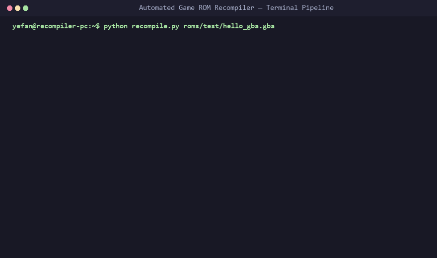
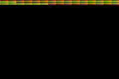

# Automated Game ROM Recompiler

[](https://github.com/yefan911/automated-recompilers/releases)
[](https://github.com/yefan911/automated-recompilers/actions/workflows/ci.yml)
[](https://github.com/yefan911/automated-recompilers/actions/workflows/build-executable.yml)
[](docs/OPCODE_COVERAGE.md)
[](docs/SHOWCASE.md)
[](https://www.python.org/)
[](LICENSE)
[](README.md)

An automated static/hybrid recompilation framework that ingests video game console ROMs and translates them into standalone native PC applications (`.exe` / Linux binary) with a built-in Hardware Abstraction Layer (HAL).

The current implementation is a prototype with partial CPU and hardware coverage. It supports ROM inspection, generated C, native homebrew execution, and GBA framebuffer snapshots. Commercial game playability, full graphics, audio output, and automatic runtime mod integration remain on the [roadmap](ROADMAP.md).

**[Try the browser demo](https://yefan911.github.io/automated-recompilers/)** — explore a generated control flow graph and selected hex-to-C instruction examples without installing anything. For native execution, use the bundled GBA homebrew below. If this work is useful to you, [star the repository](https://github.com/yefan911/automated-recompilers) to follow its progress.

[**Quick Start**](#quick-start-in-60-seconds) • 
[**Console Compatibility**](docs/COMPATIBILITY.md) •
[**Showcase & CFG**](docs/SHOWCASE.md) • 
[**Opcode Coverage**](docs/OPCODE_COVERAGE.md) • 
[**Benchmarks**](docs/BENCHMARKS.md) • 
[**Contributor Bounties**](docs/CONTRIBUTOR_BOUNTIES.md) • 
[**Awesome List**](docs/AWESOME_RECOMPILATION.md) • 
[**Why Static Recompilation?**](#why-static-recompilation) • 
[**Architecture**](#four-stage-recompilation-pipeline) • 
[**Roadmap**](ROADMAP.md) • 
[**Contributing**](CONTRIBUTING.md) • 
[**Launch Kit**](docs/LAUNCH_KIT.md)

---

## Why Static Recompilation?

Traditional emulators execute guest console code at runtime using an interpreter loop or a Just-In-Time (JIT) dynamic compiler. In contrast, **Automated Recompilation** translates foreign machine instructions **Ahead-Of-Time (AOT)** into pure native C functions that are compiled into an executable binary.

| Feature | Interpreter / Traditional Emulator | Dynamic JIT Emulator | Automated Static Recompiler (AOT) |
| :--- | :--- | :--- | :--- |
| **Execution Model** | Runtime fetch-decode loop | Runtime JIT cache compilation | **Ahead-Of-Time (AOT) compilation to C** |
| **CPU Overhead** | Instruction interpretation | Compiled blocks and JIT work | **Compiled blocks, dispatch, and hardware shims** |
| **Code Compilation** | No guest compilation | Runtime compilation | **Build-time compilation** |
| **Frame Rates** | Guest timing and host display | Guest timing and host display | **Guest timing and host presentation** |
| **Portability** | Requires emulator install | Requires JIT support (`W^X` restrictions) | **Standalone single-file `.exe`** |
| **Modding Potential** | ROM patching / memory hacking | Memory patching | **Native C source modification & hook API** |

---

## Four-Stage Recompilation Pipeline

```
  ┌───────────────────────────────────────────────────────────┐
  │                      Target ROM File                      │
  │            (.gba, .z64, .n64, .v64, .exe, .sfc)           │
  └─────────────────────────────┬─────────────────────────────┘
                                │
                                ▼
  ┌───────────────────────────────────────────────────────────┐
  │  Stage 1: Identification (src/core/rom_detector.py)       │
  │  • Normalizes endianness (Big/Little/Byte-swapped)        │
  │  • Reads identification fields & ROM checksums           │
  │  • Resolves entry vectors & banked layout (LoROM/HiROM)   │
  └─────────────────────────────┬─────────────────────────────┘
                                │
                                ▼
  ┌───────────────────────────────────────────────────────────┐
  │  Stage 2: Recursive CFG Lift (src/lifter/)                │
  │  • Recursively traces basic blocks from entry points      │
  │  • ISA Lifters: ARM7TDMI, Thumb-16, MIPS I/III, 65816     │
  │  • Resolves delay slots & spin loops                      │
  └─────────────────────────────┬─────────────────────────────┘
                                │
                                ▼
  ┌───────────────────────────────────────────────────────────┐
  │  Stage 3: C Code Generation (src/lifter/cfg.py)           │
  │  • Emits clean `bb_XXXXXXXX` C functions                  │
  │  • Virtual register context (ArmCpuContext, MipsContext)  │
  │  • High-performance `recomp_dispatch` trampoline         │
  └─────────────────────────────┬─────────────────────────────┘
                                │
                                ▼
  ┌───────────────────────────────────────────────────────────┐
  │  Stage 4: Native Compile (src/core/native_compiler.py)    │
  │  • Links lightweight Hardware Abstraction Layer (HAL)     │
  │  • Compiles via MSVC, Clang, or GCC (-O2 optimizations)   │
  └─────────────────────────────┬─────────────────────────────┘
                                │
                                ▼
  ┌───────────────────────────────────────────────────────────┐
  │          Standalone Native Binary (.exe / elf)            │
  │       Runs natively on PC with Win32 / GDI window         │
  └───────────────────────────────────────────────────────────┘
```

---

## Demo Walkthrough



> 📹 **Interactive HD Video Walkthrough:** [`docs/demo/recompiler_interactive_demo.webm`](docs/demo/recompiler_interactive_demo.webm)  
> 🌐 **Interactive Web Inspector & CFG Visualizer:** [Open the hosted demo](https://yefan911.github.io/automated-recompilers/).



---

## Quick Start in 60 Seconds

A 100% legal, standalone homebrew test ROM (`roms/test/hello_gba.gba`) is included so you can test the pipeline immediately without commercial ROM dumps.

Install Python 3.10–3.13 and a C compiler (MSVC, Clang, or GCC). The CLI uses the Python standard library; install `requirements-dev.txt` for tests, packaging, and the GUI's image previews. Packaged builds also need a C compiler to produce guest executables.

### 1. Recompile the Test ROM
```bash
# Recompiles the ROM to native C and compiles the .exe
python recompile.py roms/test/hello_gba.gba
```

### 2. Run the Native Executable
```bash
# Launch with native Win32 window displaying rendered pixels:
.\build\hello_gba.exe --window
```

For a bounded run and a framebuffer image:

```bash
.\build\hello_gba.exe --headless --framebuffer build\hello_gba.ppm
```

On Linux, run `./build/hello_gba.exe --headless --framebuffer build/hello_gba.ppm`. The compiler currently keeps the `.exe` filename on both platforms. Desktop presentation currently uses Win32.

The bundled homebrew initializes GBA Mode 3 and writes 2,400 pixels. The PPM snapshot contains the framebuffer produced by that execution.

---

## Standalone Executable (`recompiler.exe`)

You can package the entire automated recompilation framework into a standalone binary that does not require Python or external dependencies:

```bash
# Package into dist/recompiler.exe
python package_exe.py

# Run directly:
.\dist\recompiler.exe roms/test/hello_gba.gba
.\dist\recompiler.exe --blocks roms/test/hello_gba.gba
```

---

## Interactive Graphical User Interface (GUI)

The framework includes a dark-themed desktop GUI for visual ROM selection, metadata inspection, Shannon entropy analysis, and one-click recompilation:

The viewport offers **ROM Data** preview, **Native Snapshot** for a compiled GBA ROM, and **Native Window** to launch a compiled guest. Native Snapshot captures the framebuffer after execution completes.

```bash
# Launch via CLI option
python recompile.py --ui

# Or launch directly
python gui.py

# Or launch with the standalone executable
.\dist\recompiler.exe --ui
```

---

## Directory Structure

```
automated_recompilers/
├── roms/                       # Dumped ROM workspace
│   ├── gba/                    # Game Boy Advance ROMs (.gba)
│   ├── n64/                    # Nintendo 64 ROMs (.z64, .n64, .v64)
│   ├── ps1/                    # PlayStation 1 images (.bin/.cue, .iso, .exe)
│   ├── snes/                   # Super Nintendo ROMs (.sfc, .smc)
│   └── test/                   # Homebrew & diagnostic test ROMs
│
├── src/
│   ├── core/                   # ROM detection, block analysis & native compiler driver
│   │   ├── rom_detector.py     # Detects console format, endianness, entry vectors
│   │   ├── block_analyzer.py   # Shannon entropy map & CFG block inspector
│   │   ├── data_block_reader.py# Banking & data block reader interface
│   │   ├── native_compiler.py  # MSVC / Clang / GCC compiler interface
│   │   └── create_test_rom.py  # Test ROM generator (ARM7TDMI Mode 3)
│   ├── lifter/                 # Binary disassemblers and IR code generators
│   │   ├── arm_lifter.py       # ARM7TDMI recursive CFG lifter & C code generator
│   │   ├── thumb_lifter.py     # Thumb-16 lifter with ARM interworking (BX)
│   │   ├── mips_lifter.py      # MIPS I / III lifter (N64 / PS1)
│   │   ├── snes_lifter.py      # W65C816S lifter (SNES 24-bit banked ISA)
│   │   └── cfg.py              # Control Flow Graph & basic block manager
│   └── runtime/                # Hardware Abstraction Layer (Display, Audio, MMIO)
│
├── build/                      # Generated C sources (.c) and compiled binaries (.exe)
├── docs/                       # Architecture diagrams, case studies, demos & launch kit
│   ├── demo/                   # Interactive HD video demo (.webm) & terminal walkthrough (.gif)
│   ├── index.html              # Interactive web playground & CFG visualizer
│   ├── showcase.html           # Responsive single-ROM CFG showcase
│   ├── SHOWCASE.md             # Markdown CFG flowcharts with Mermaid.js
│   ├── BENCHMARKS.md           # Frame latency, CPU utilization & lifter throughput
│   ├── OPCODE_COVERAGE.md      # Multi-architecture opcode metrics (ARM, Thumb, MIPS, 65816)
│   ├── CONTRIBUTOR_BOUNTIES.md # Gamified good-first-issues catalog
│   ├── AWESOME_RECOMPILATION.md# Curated list of static recompilers and papers
│   ├── ARCHITECTURE.md         # Framework technical design specification
│   ├── CASE_STUDIES.md         # Breakdowns of N64Recomp, GBARecomp, PS1Recomp
│   └── LAUNCH_KIT.md           # Community announcements, blog posts & social threads
├── scripts/                    # Automation, benchmarking & showcase tools
│   ├── benchmark_suite.py      # Micro-benchmark harness for instruction lifters
│   ├── generate_showcase.py    # Automated CFG markdown & HTML showcase generator
│   ├── opcode_coverage.py      # Opcode coverage tracker & dynamic badge generator
│   ├── opcode_bounty.py        # Good-first-issue template & test generator
│   └── record_demo.py          # Playwright HD video & Pillow animated GIF recorder
├── gui.py                      # Interactive desktop GUI application
├── package_exe.py              # Zero-dependency executable packaging utility
├── recompile.py                # Unified CLI entry point
├── ROADMAP.md                  # Development milestones and planned features
└── CONTRIBUTING.md             # Developer setup and guide to adding instructions
```

---

## Supported Consoles & Instruction Lifters

| Console | CPU Architecture | Lifter Status | Notes |
| :--- | :--- | :--- | :--- |
| **Game Boy Advance** | ARM7TDMI (ARMv4T) + Thumb-16 | Prototype | Core ALU and memory operations, interworking (`BX`), verified Mode 3 homebrew snapshot |
| **Nintendo 64** | MIPS III (VR4300) | In Progress | Delay slot handling, conditional branches, CFG tracing |
| **PlayStation 1** | MIPS I (R3000A) | In Progress | MIPS I lifting, PS-X EXE detection |
| **Super Nintendo** | W65C816S | In Progress | 24-bit banked LoROM addressing, `REP`/`SEP` register sizing |

---

## Step-by-Step Guide: How to Recompile a Game

### Step 1: Scan and Inspect ROMs
Run the CLI without arguments to scan the workspace and identify console headers:
```bash
python recompile.py
```

Inspect the internal structure and Shannon entropy map of any ROM before recompiling:
```bash
python recompile.py --blocks roms/n64/testfile.z64
python recompile.py --blocks roms/test/hello_gba.gba
```
This generates:
1. **ROM Header Analysis:** Title, internal serial code, entry point, CRC.
2. **Shannon Entropy Map:** Visual graph identifying executable code vs. compressed audio/texture blocks.
3. **CFG Basic Block Breakdown:** Disassembles initial instructions, branch paths, and delay slots.

### Step 2: Recompile to Native C & Binary
```bash
python recompile.py roms/test/hello_gba.gba
```
*(Optional: add `--no-build` to generate `build/hello_gba_recompiled.c` without calling the native compiler)*

### Step 3: Run the Native Game
```bash
# Fast verification in terminal:
.\build\hello_gba.exe

# Open native 720×480 desktop presentation window:
.\build\hello_gba.exe --window
```

---

## Testing & Continuous Integration

Every commit is verified across Python 3.10 through 3.13 on Ubuntu and Windows. The CI pipeline compiles the generated C source with `-Wall -Wextra -Werror -O2` and runs it end-to-end.

To run the test suite locally:
```bash
pytest -v
```

---

## License

This project is licensed under the [MIT License](LICENSE).
