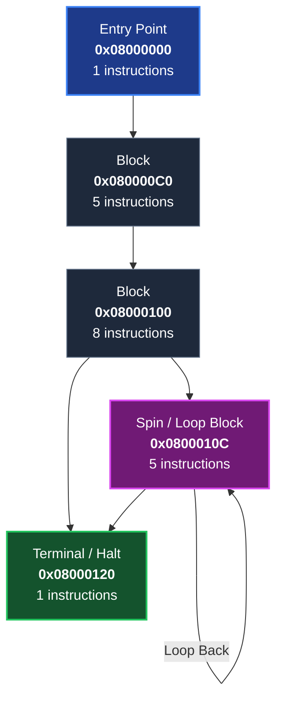

# 🚀 Automated Recompiler — Visual Showcase & Technical Architecture

This showcase demonstrates the end-to-end Ahead-of-Time (AOT) static recompilation pipeline, from raw binary ROM analysis to recursive Control Flow Graph (CFG) extraction and standalone native C code generation.

## 🎮 Verified Test ROM Profile
- **File:** `roms/test/hello_gba.gba`
- **Target Console:** Game Boy Advance (GBA) (ARM7TDMI (32-bit ARM + 16-bit Thumb))
- **Entry Vector:** `0x08000000`
- **Discovered Basic Blocks:** **5**
- **Total Lifted Instructions:** **20**
- **CFG Extraction Latency:** **0.41 ms**

---

## 🗺️ Recursive Control Flow Graph (CFG)
The recompiler starts at the entry vector and traces basic block boundaries, identifying branch targets, interworking state switches, and terminal spin loops.



---

## 🔬 Before & After: Binary Disassembly vs. Emitted C99
Notice how foreign ARM registers (`r0`, `r1`, `sp`, `lr`) are mapped directly to native CPU context structures (`ArmCpuContext`), eliminating runtime JIT cache overhead entirely:

```armasm
// Raw ARM7TDMI Machine Code & Assembly
080000C0: E3A00003    mov  r0, #3          ; Video Mode 3 (240x160 16bpp)
080000C4: E3A01B01    mov  r1, #0x400      ; BG2 Enable flag
080000C8: E1800001    orr  r0, r0, r1      ; Mode 3 | BG2
080000CC: E58F1024    ldr  r1, =0x04000000 ; REG_DISPCNT address
080000D0: E1A00000    nop
080000D4: EA000009    b    0x08000100      ; Jump to framebuffer loop
```

```c
// Emitted Standalone C99 Code (Clean & Zero Dependencies)
uint32_t bb_080000C0(ArmCpuContext* ctx) {
    (void)ctx;
    ctx->r[0] = 0x00000003;
    ctx->r[1] = 0x00000400;
    ctx->r[0] = ctx->r[0] | ctx->r[1];
    ctx->r[1] = 0x04000000; /* loaded from pool */
    /* branch */
    return 0x08000100;
}
```

---

## 📊 Shannon Entropy Distribution Map
Shannon entropy distinguishes pure machine code from compressed assets and padding:

| Slice | Offset Range | Entropy (0.0 - 8.0) | Classification |
| :---: | :---: | :---: | :--- |
| #0 | `0x000000` - `0x000040` | `5.70` ███████████ | Code / Logic |
| #1 | `0x000040` - `0x000080` | `5.74` ███████████ | Code / Logic |
| #2 | `0x000080` - `0x0000C0` | `4.55` █████████ | Code / Logic |
| #3 | `0x0000C0` - `0x000100` | `2.11` ████ | Code / Logic |
| #4 | `0x000100` - `0x000140` | `3.61` ███████ | Code / Logic |
| #5 | `0x000140` - `0x000180` | `0.00`  | Padding / Header |
| #6 | `0x000180` - `0x0001C0` | `0.00`  | Padding / Header |
| #7 | `0x0001C0` - `0x000200` | `0.00`  | Padding / Header |
| #8 | `0x000200` - `0x000240` | `0.00`  | Padding / Header |
| #9 | `0x000240` - `0x000280` | `0.00`  | Padding / Header |
| #10 | `0x000280` - `0x0002C0` | `0.00`  | Padding / Header |
| #11 | `0x0002C0` - `0x000300` | `0.00`  | Padding / Header |
| #12 | `0x000300` - `0x000340` | `0.00`  | Padding / Header |
| #13 | `0x000340` - `0x000380` | `0.00`  | Padding / Header |
| #14 | `0x000380` - `0x0003C0` | `0.00`  | Padding / Header |
| #15 | `0x0003C0` - `0x000400` | `0.00`  | Padding / Header |

---

## ⚡ Why Static Recompilation Beats Emulation
| Feature | Traditional Emulators | Automated Recompiler (AOT) |
| :--- | :--- | :--- |
| **Compilation Model** | Runtime Interpreter or JIT | Ahead-Of-Time (AOT) C Translation |
| **Startup Stutter** | Frequent (JIT compilation stalls) | **Zero (Native machine code)** |
| **Frame Rates** | Locked to original console refresh | **Uncapped (144Hz / 240Hz+)** |
| **Output Artifact** | Requires emulator binary + ROM | **Standalone `.exe` native binary** |
| **Modding & Shaders** | Difficult (RAM hacking) | **Native C source modification** |

👉 **[Read the Full Launch Kit](../docs/LAUNCH_KIT.md)** | **[Contribute Instruction Lifters](../CONTRIBUTING.md)**
